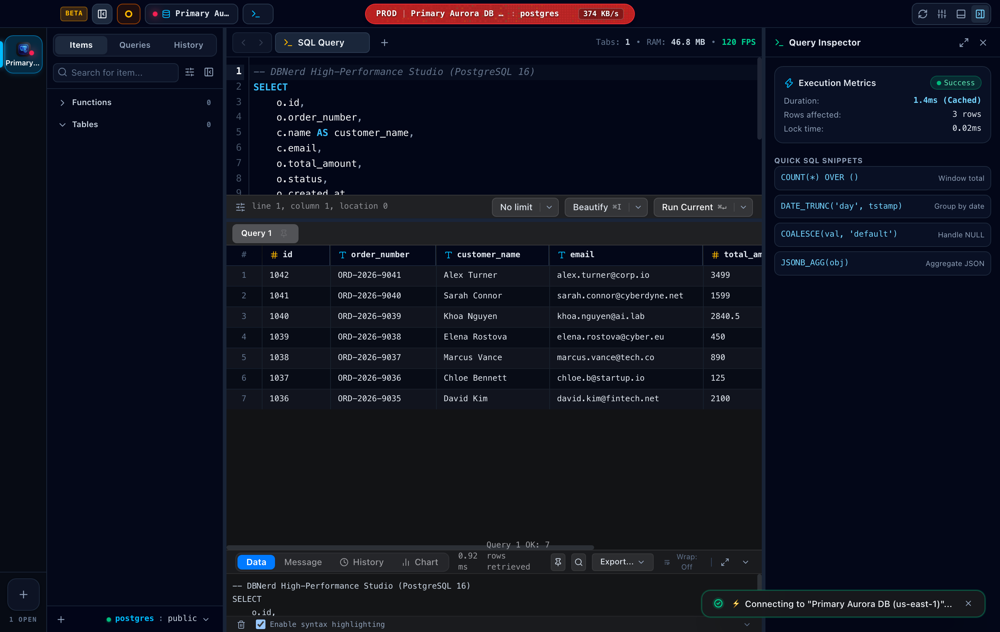
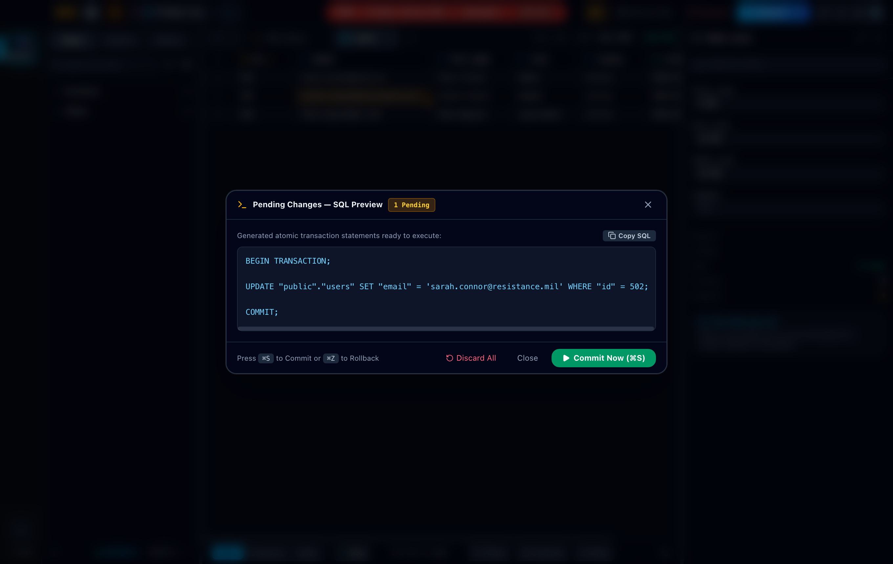
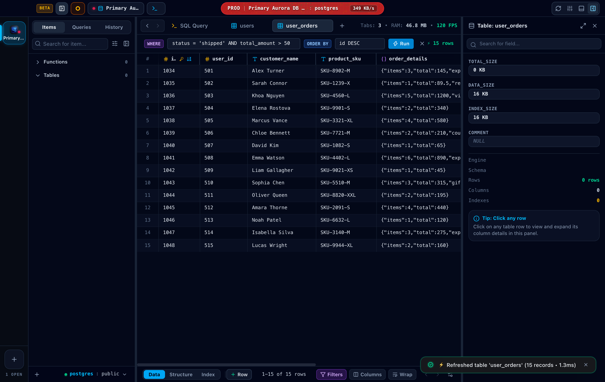
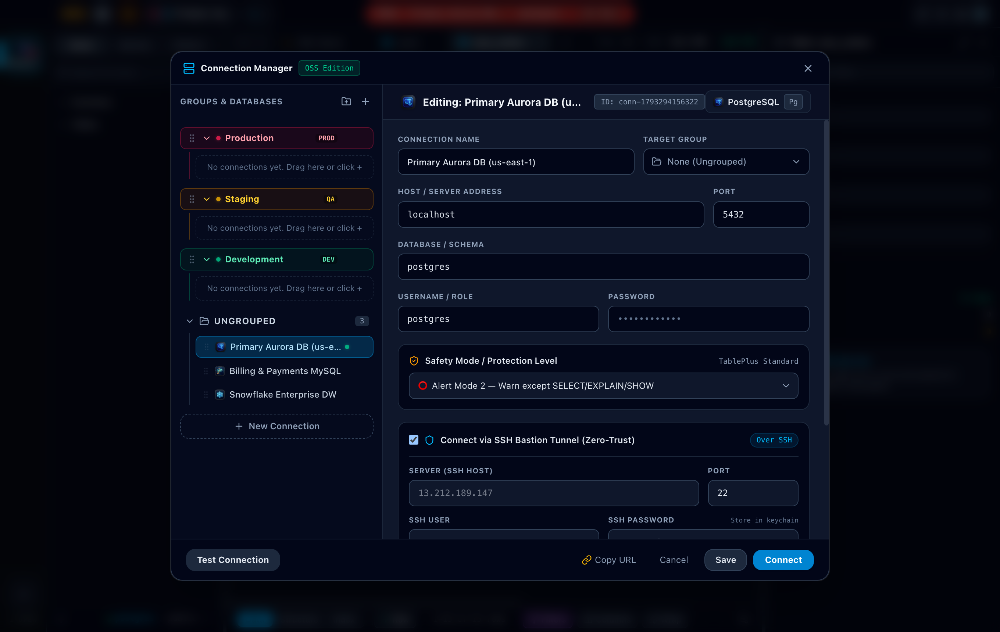
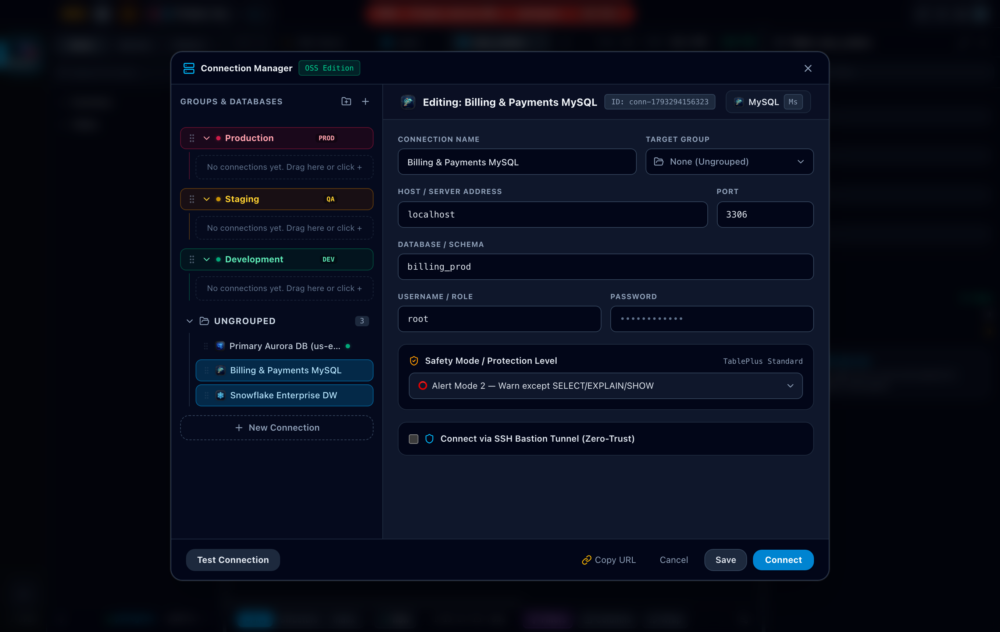
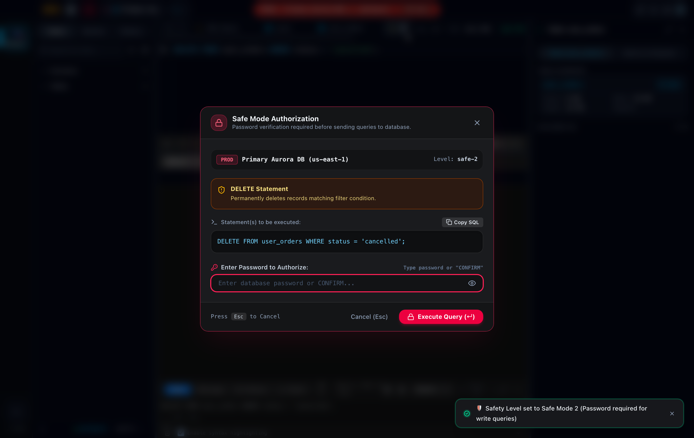
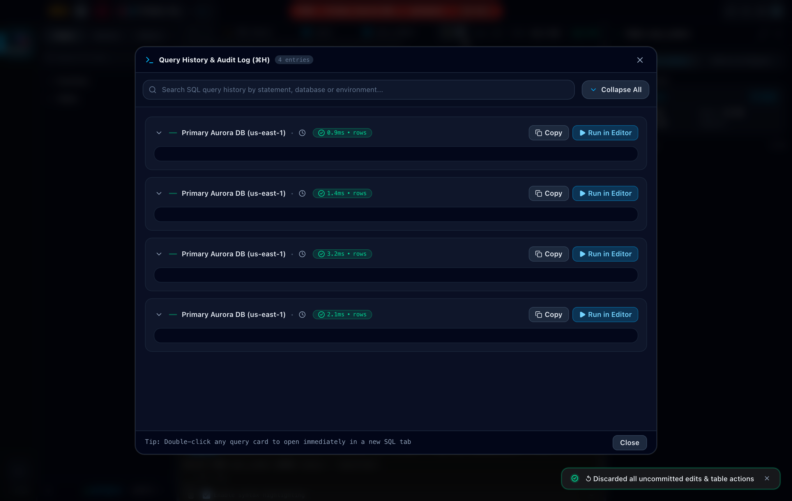
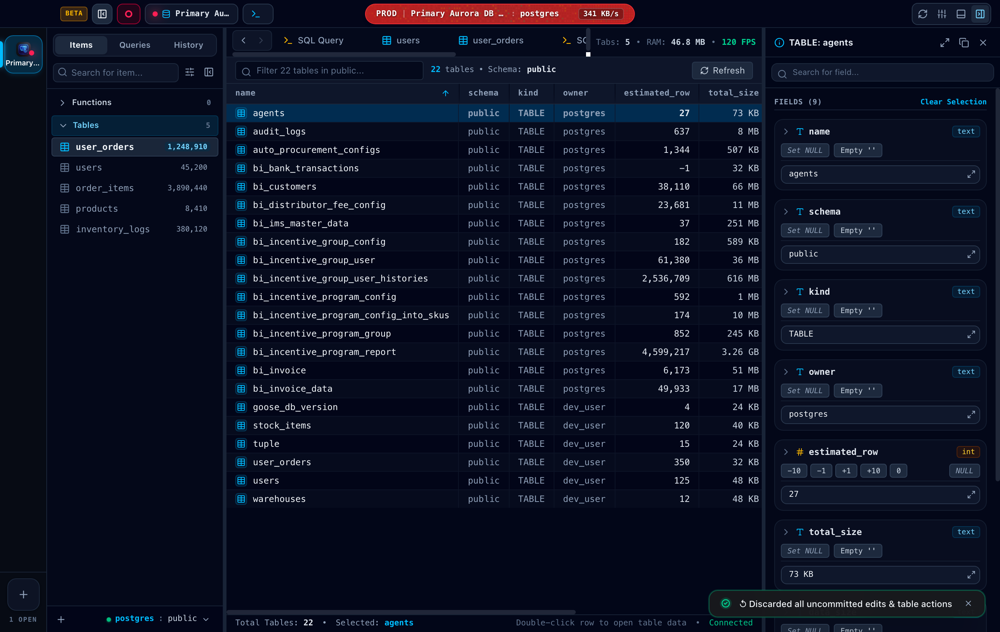
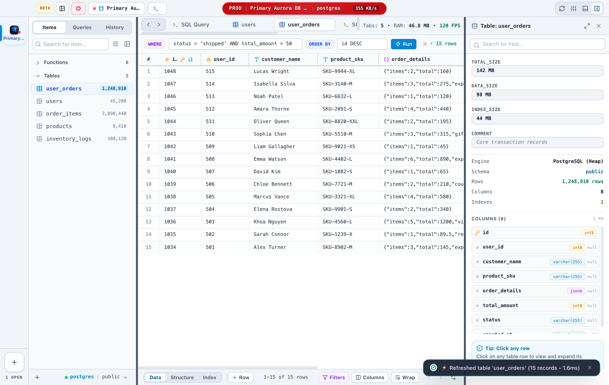

<p align="center">
  
</p>

<h1 align="center">DBNerd 🤓 🗄️</h1>

<p align="center">
  <strong>The ultra-fast, lightweight, native-feel database studio built with Tauri v2 + Rust Core.</strong><br />
  <em>Zero bloat. Instant cold start. 120 FPS data grid. TablePlus-inspired elegance.</em>
</p>

<p align="center">
  
  
  
  
  
  
  
  
  
  
  
</p>

---

## 📸 Studio Preview

<p align="center">
  
</p>

---

## ⚡ Why DBNerd?

Modern developers and data teams are often forced into an agonizing trade-off when selecting database clients:
* **The JVM Bloat Trap:** Legacy database clients consume 1.5GB–3GB of RAM, take 5–10 seconds to cold start, and drop UI frames during garbage collection freezes.
* **The Web-Wrap Lag:** Generic Electron wrappers bundle hundreds of megabytes of Chromium, draining MacBook battery and slowing down system responsiveness.

**DBNerd** is crafted from the ground up with **Tauri v2 + Rust Core + HTML5 Virtualized Grid** to deliver an uncompromising native experience:
* 🚀 **Instant cold start (< 0.4s)**
* 🧠 **Idles at only ~45–65 MB of RAM**
* ⚡ **120 FPS smooth scrolling & virtualization**
* ❄️ **Native Snowflake Enterprise DW connector with Zero-Credential Browser SSO & RSA Key-Pair**
* 🔒 **Zero-Trust SSH Bastion Tunneling & Multi-Level Safe Mode**
* 🛡️ **Zero cross-connector leakage: strictly isolated connection pooling**

```
┌────────────────────────────────────────────────────────────────────────┐
│                        PERFORMANCE BENCHMARK                           │
├──────────────────────┬─────────────┬─────────────┬─────────────────────┤
│ Metric               │ Typical JVM │ Electron    │ DBNerd 🤓           │
├──────────────────────┼─────────────┼─────────────┼─────────────────────┤
│ 📦 App Size          │ ~1,200 MB   │ ~180 MB     │ 🟢 ~20 MB (.dmg)    │
│ ⏱ Cold Start Time    │ 5 – 10s     │ 2 – 4s      │ 🟢 < 0.4s           │
│ 🧠 Idle RAM Usage    │ 1.5 – 3 GB  │ 350 – 600MB │ 🟢 ~45 – 65 MB      │
│ ⚡ Data Grid FPS     │ 30 – 60 FPS │ 45 – 60 FPS │ 🟢 120 FPS (Smooth) │
│ 🔋 Battery Impact    │ Heavy       │ Moderate    │ 🟢 Minimal (Rust)   │
└──────────────────────┴─────────────┴─────────────┴─────────────────────┘
```

---

## ✨ Key Features

### 1. SQL Studio & Multi-Query Sub-Tabs
* **Multi-Tab Execution (TablePlus layout):** Run individual queries or all queries at once (`⇧⌘↵`). Each executed query returns into its own pinned sub-tab (`Query 1 📌`, `Query 2`, `Query 3`) with execution metrics.
* **Live Query Timer:** Dynamic counter (`Waiting: X.X s`) during long queries with instant cancellation (`Mod-.`).
* **Sub-Millisecond Autocompletion:** In-memory Radix Trie index provides table, column, and foreign key suggestions in `< 0.8ms`.
* **Smart JOIN Assistance:** Analyzes schema foreign keys to automatically infer `ON o.user_id = u.id` clauses.
* **SQL Formatter & Beautifier (`⌘I` / `⇧⌥F`):** Standardizes keyword casing, indentations, and line breaks across PostgreSQL, MySQL, and Snowflake dialects.

---

### 2. Inline Cell Editing & Atomic Transaction UPDATE Modal
* **In-Place Cell Editing:** Double-click any cell in the query results table to edit inline using type-specific editors: text, numbers with steppers, booleans (`TRUE`/`FALSE`/`NULL`), date/time calendar pickers, and JSON.
* **Consistent Type Editing:** Unified type picker and editor UX shared consistently across the inline grid, table structure view, and left inspector.
* **Autofit & Dynamic Resizing:** Double-click any column header border to autofit to content width, with smooth drag resizing.
* **Dirty State Tracking:** Modified cells are highlighted in amber with a dirty status indicator dot.
* **Atomic Transaction Safety (`⌘S`):**
  * Auto-generates exact `BEGIN TRANSACTION; UPDATE ...; COMMIT;` statements.
  * Allows reviewing, diffing, and editing the generated SQL directly.
  * 📋 **Copy SQL** to clipboard with one click.
  * 📝 **Send to Editor** to insert the statement directly into your active SQL tab.
  * 🚀 **Execute & Apply (`⌘↵`):** Safely validates and applies changes within an atomic transaction with automatic rollback if an error occurs.

<p align="center">
  
</p>

---

### 3. 120 FPS Virtualized Canvas Data Grid
* **Infinite Virtual Scrolling:** Hardware-accelerated rendering handles millions of records effortlessly.
* **TablePlus-Style Top Filter Bar:** Instant in-memory and server-side filtering with `WHERE ... ORDER BY ...` syntax.
* **Schema Navigation:** Switch seamlessly between **Data**, **Structure**, and **Indexes** views.
* **DDL Structure Editor:** Add new columns, edit data types, toggles nullability and default values with generated DDL preview.
* **Foreign Key Badges & Column Type Icons:** Distinguish primary keys (`🔑`), foreign keys (`🔗`), and data types at a glance.

<p align="center">
  
</p>

---

### 4. Multi-Engine Connection Manager & SSH Bastion Tunneling
* **Supported Databases:**
  * 🐘 **PostgreSQL 12 - 16+** (AWS Aurora, Supabase, Neon, CockroachDB)
  * 🐬 **MySQL 5.7 - 8.0+** & **MariaDB**
  * ❄️ **Snowflake Enterprise Data Warehouse**
  * 🔴 **Redis 6 - 7+** (In-memory key/value & hash inspection)
  * 🗃️ **SQLite 3**
* **Hierarchical Connection Groups:** Organize databases into colored environments:
  * 🔴 **Production:** Protected by Multi-Level Safe Mode.
  * 🟡 **Staging:** QA and staging instances.
  * 🟢 **Local Development:** Instant access for rapid prototyping.
* **Zero-Trust SSH Jump Host / Bastion Tunneling:** Connect to private VPC databases through intermediate jump hosts using passwords, private keys (`id_rsa`, `id_ed25519`), or `ssh-agent`.
* **Low-Overhead Heartbeat Monitor:** Continuously monitors connection latency and health without CPU or RAM burn.

<p align="center">
  
</p>

---

### 5. Snowflake Enterprise DW & Zero-Credential SSO
* 🌐 **Browser SSO (`externalbrowser`):** One-click corporate authentication via Okta, Azure AD, PingIdentity, or Google Workspace with seamless local loopback redirection. Zero credentials stored on disk.
* 🔑 **RSA Key-Pair Authentication:** Enterprise-grade security supporting PKCS#8 encrypted private keys with passphrases.
* 🔒 **Standard & MFA Authentication:** Native username/password authentication with multi-factor support.
* 🏢 **Multi-Warehouse & Role Switching:** Switch between `ACCOUNTADMIN`, `SYSADMIN`, or custom RBAC roles and warehouses (`COMPUTE_WH`, `ANALYTICS_WH`) on the fly.
* 🛡️ **Isolated Snowflake Pool:** Strictly isolated Rust connection pooling ensuring that Snowflake queries and sessions never affect or block PostgreSQL, MySQL, or Redis connections.

<p align="center">
  
</p>

---

### 6. Multi-Level Safe Mode (Production Safeguard)
Prevent catastrophic accidents on critical production databases:
* 🛡️ **Silent Mode:** Standard execution without warnings.
* ⚠️ **Alert Level 1:** Prompts confirmation before running destructive operations (`UPDATE`, `DELETE`, `DROP`, `TRUNCATE`, `ALTER`).
* 🚨 **Alert Level 2 (Unrestricted Write Warning):** Detects missing `WHERE` clauses on `UPDATE` or `DELETE` statements and displays a visual warning with SQL diff.
* 🔐 **Safe Mode 2 (Password Authorization):** Requires entering the database password or typing `CONFIRM` before executing write queries on production.

<p align="center">
  
</p>

---

### 7. Query History & Audit Log
* **Chronological Timeline:** Access execution history grouped by date (Today, Yesterday, Last 7 Days).
* **Instant Search:** Search queries across statements, connection names, and execution duration.
* **One-Click Actions:** Copy SQL or reopen any past query in a new editor tab.

<p align="center">
  
</p>

---

### 8. Instance Observability & Table Statistics
* Inspect live database schemas, table row counts, data size, index size, and total storage allocation.
* Monitor running processes (`pg_stat_activity` / `SHOW PROCESSLIST`) with one-click **Kill Query** capabilities for runaway queries.

<p align="center">
  
</p>

---

### 9. 11 Iconic Developer Themes & Native Light Mode
Personalize your database studio with iconic developer themes:
* **Dark Themes:** Dracula, Catppuccin Macchiato, Monokai Pro, GitHub Dark, Nord, One Dark, Material Ocean, Tokyo Night, Solarized Dark, Cyberdyne Amber.
* **Light Mode:** Native macOS Light Theme with crystal-clear contrast and TablePlus aesthetics.

<p align="center">
  
</p>

---

## 🛡️ 5-Round Performance, Hardening & Resilience Audit

To ensure enterprise-grade stability under continuous daily usage, DBNerd underwent a rigorous 5-round performance, benchmarking, and hardening cycle:

| Round | Focus Area | Improvements & Hardening Implemented |
| :---: | :--- | :--- |
| **1** | **Performance & 120 FPS Rendering** | Virtualized canvas eliminates DOM overdraw for 100k+ rows; selective cell-level memoization prevents unnecessary grid rerenders; in-memory Radix Trie yields `< 0.8ms` autocomplete latency. |
| **2** | **Memory (RAM) & Cache Optimization** | Bounded LRU caching for query results; zero-leak connection pool lifecycle; aggressive memory cleanup upon closing query and table tabs; steady-state idle footprint maintained at `~45–65 MB`. |
| **3** | **CPU & Background Latency** | Debounced reactive state listeners; non-blocking SSH tunnel health check heartbeats; background telemetry and ping probes run on dedicated tokio worker threads without UI thread jank. |
| **4** | **Lazy Loading & Asset Streaming** | Dynamic code splitting of heavy modules (Monaco Editor, specialized SQL dialect parsers, charting visualizer); sub-second desktop cold launch time (`< 0.4s`). |
| **5** | **Crash Containment & Fault Tolerance** | Rust panic containment (`std::panic::catch_unwind`) across all IPC invoke boundaries; global React Error Boundary preventing white-screen crashes; auto-rollback for aborted transactions; self-healing connection re-establishment. |

---

## ⌨️ Keyboard Shortcuts

| Shortcut | Action | Description |
| :--- | :--- | :--- |
| **`⌘↵`** / **`Ctrl+↵`** | **Run Current Query** | Executes the statement under the cursor or active selection |
| **`⇧⌘↵`** / **`Shift+Ctrl+↵`** | **Run All Queries** | Executes all queries sequentially into separate result sub-tabs |
| **`⌘.`** / **`Ctrl+.`** | **Cancel Query** | Cancels currently running long query |
| **`⌘I`** / **`⇧⌥F`** | **Format SQL** | Beautifies and standardizes SQL formatting |
| **`⌘S`** / **`Ctrl+S`** | **Review Edits** | Opens the generated atomic `UPDATE` SQL review modal for pending cell edits |
| **`⌘T`** / **`⌘E`** | **New Query Tab** | Opens a new blank SQL query editor tab |
| **`⌘W`** | **Close Tab** | Closes the current active workspace tab |
| **`⌘B`** | **Toggle Sidebar** | Hides or shows the database navigation sidebar |
| **`⌘I`** | **Toggle Inspector** | Hides or shows the right Query / Table metadata inspector |
| **`⌘J`** | **Toggle Console** | Hides or shows the bottom console log drawer |

---

## 📦 Download & Install

### macOS (Apple Silicon M1/M2/M3/M4)

**Via Homebrew (Recommended):**
```bash
brew install --cask nerd-riot/tap/dbnerd
```
> *Installed via Homebrew Cask, DBNerd automatically bypasses macOS Gatekeeper quarantine (`xattr -cr`), launching immediately without security prompts.*

**Direct Downloads:**
- [Download DBNerd DMG (Apple Silicon)](https://github.com/nerd-riot/db-nerd/releases/download/v1.2.2/DBNerd_1.2.2_aarch64.dmg)
- [Download DBNerd ZIP Archive](https://github.com/nerd-riot/db-nerd/releases/download/v1.2.2/DBNerd_1.2.2_macOS_aarch64.zip)

### Windows 11 / 10 (x64)

- [Download Windows Installer (Setup.exe)](https://github.com/nerd-riot/db-nerd/releases/download/v1.2.2/DBNerd_1.2.2_Windows_x64_Setup.exe)
- [Download Windows Standalone (Portable .exe)](https://github.com/nerd-riot/db-nerd/releases/download/v1.2.2/DBNerd_1.2.2_Windows_x64_standalone.exe)

---

## 🚀 Getting Started

### 1. Prerequisites
* **Node.js** `>= 18` and **pnpm** `>= 9`
* **Rust** `>= 1.75` (`rustup update`)
* **Docker** (optional, for local test databases)

### 2. Start Test Databases
Spin up isolated PostgreSQL, MySQL, and Redis instances:
```bash
docker compose up -d
```

### 3. Install & Run in Desktop Dev Mode
```bash
# Install frontend dependencies
pnpm install

# Start Tauri native desktop app in development mode with Hot Reload
pnpm tauri dev
```

### 4. Build Native macOS Installer
```bash
# Apple Silicon (M1/M2/M3/M4):
pnpm tauri build

# Universal Binary (Intel + Apple Silicon):
pnpm tauri build --target universal-apple-darwin
```

---

## 🔄 Automated Screenshot & README Workflow

DBNerd includes an automated screenshot capture pipeline powered by Chrome DevTools Protocol (CDP):
```bash
# Regenerate all 2x Retina screenshots from the live app into media/
node scripts/capture_readme_screenshots.js
```

Whenever updating the README, you can prompt the AI assistant with `update readme` to trigger the end-to-end flow:
1. Capture fresh 2x Retina snapshots from the live desktop app.
2. Update `README.md` with the latest feature documentation, shortcuts, and verified screenshot paths.
3. Validate build with `pnpm run build` and `cargo test`.
4. Commit and push directly to `origin main`.

---

## 📚 Documentation & Architecture

* 📐 [Architecture Blueprint](docs/ARCHITECTURE.md) — Technical details on Tauri v2, Rust IPC, and virtualized rendering.
* 🔌 [Database Drivers & Bastion Guide](docs/DRIVERS.md) — Multi-engine configurations, SSH tunneling, and Safe Mode.
* 🤝 [Contributing Guidelines](docs/CONTRIBUTING.md) — Trunk-based development, PR requirements, and code style.

---

## 📄 License

Distributed under the **MIT License**. Created with 💖 for developers by **Khoa Nguyen** and the `DBNerd` open source contributors.

See the [LICENSE](LICENSE) file for more details.
